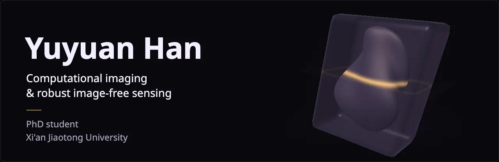
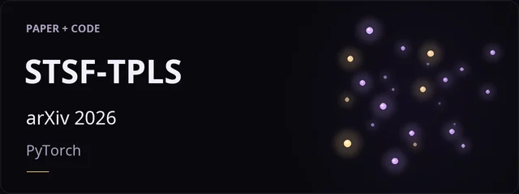
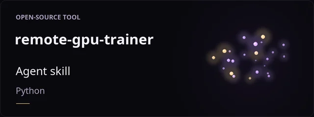
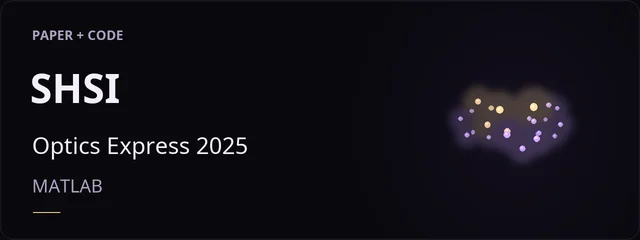
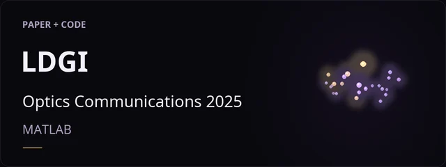

  

  
  
  
  
  

I study how optical measurements shape what machines can infer, and how to make that inference reliable with limited, noisy data. I connect measurement design, reconstruction and direct inference to understand what makes perception robust.

- **Now:** Time-domain diffuse optical tomography for 3D brain imaging; acquisition-aware single-pixel sensing on an optical bench; exploratory question answering from measurements with a frozen vision–language model.
- **Long term:** help robots interpret the physical world from raw measurements and physical models.

I welcome research collaborations and internships that combine measurements and physical models to help machines learn and reason reliably, with applications in scientific discovery and embodied systems.

### Featured work

<table width="100%">
  <tr>
    <td width="50%" align="center"> <a href="https://github.com/Hanyuyuan6/STSF-TPLS"><strong>STSF-TPLS</strong></a> Image-free sensing</td>
    <td width="50%" align="center"> <a href="https://github.com/Hanyuyuan6/remote-gpu-trainer"><strong>remote-gpu-trainer</strong></a> GPU experiment automation</td>
  </tr>
  <tr>
    <td width="50%" align="center"> <a href="https://github.com/Hanyuyuan6/SHSI"><strong>SHSI</strong></a> Noise-resilient imaging</td>
    <td width="50%" align="center"> <a href="https://github.com/Hanyuyuan6/LDGI"><strong>LDGI</strong></a> OPA line-pattern imaging</td>
  </tr>
</table>

Animations are conceptual illustrations. <a href="VISUALS.md">View still images</a>.

<b>Papers and more code</b>

 

- **The Lift Spectrum: How Measurement-to-Space Adaptivity Shapes Robustness in Image-Free Single-Pixel Sensing**, arXiv 2026 · [paper](https://arxiv.org/abs/2607.22077) · [code](https://github.com/Hanyuyuan6/STSF-TPLS)
- **Generalized sparse Hadamard single-pixel Imaging**, Optics Express 2025 · [paper](https://doi.org/10.1364/OE.576533) · [code](https://github.com/Hanyuyuan6/SHSI)
- **Loop differential ghost imaging based on line pattern**, Optics Communications 2025 · [paper](https://doi.org/10.1016/j.optcom.2025.131589) · [code](https://github.com/Hanyuyuan6/LDGI)
- All nine papers, with BibTeX: [hanyuyuan6.github.io/#publications](https://hanyuyuan6.github.io/#publications)
- [Comparison-of-SPI-DLs](https://github.com/Hanyuyuan6/Comparison-of-SPI-DLs): eight deep networks and correlation ghost imaging, benchmarked on one shared Hadamard acquisition
- [TGIs-Entry](https://github.com/Hanyuyuan6/TGIs-Entry): reference implementations of traditional, differential and normalized ghost imaging

