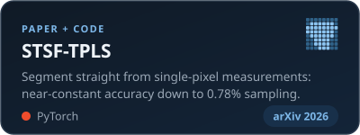
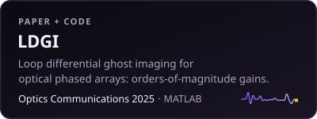

  
   
  The trace is my portrait as a single-pixel camera would record it: 192 Walsh–Hadamard measurements, drawn to scale.

  
  
  
  
  

I work on single-pixel imaging and image-free sensing: I design optical measurements and train networks that operate directly on the measurement sequence, without first reconstructing an image. A single-pixel camera illuminates a scene with structured patterns and records one value per pattern with a single detector; I study how much a machine can perceive from those values alone.

- **Now:** Acquisition-aware single-pixel sensing with optical-bench tests (manuscript in preparation); question answering on single-pixel measurements (exploratory). Planned at Politecnico di Milano: time-domain diffuse optical tomography.
- **Long term:** Robotic systems that infer physical parameters and interpret their surroundings directly from raw measurements, guided by physical models.
- **Open to:** research collaborations and internships in computational imaging, image-free sensing and machine perception.

### Featured work

  
  
  
  

<b>Papers and more code</b>

 

- **The Lift Spectrum: How Measurement-to-Space Adaptivity Shapes Robustness in Image-Free Single-Pixel Sensing**, arXiv 2026 · [paper](https://arxiv.org/abs/2607.22077) · [code](https://github.com/Hanyuyuan6/STSF-TPLS)
- **Generalized sparse Hadamard single-pixel Imaging**, Optics Express 2025 · [paper](https://doi.org/10.1364/OE.576533) · [code](https://github.com/Hanyuyuan6/SHSI)
- **Loop differential ghost imaging based on line pattern**, Optics Communications 2025 · [paper](https://doi.org/10.1016/j.optcom.2025.131589) · [code](https://github.com/Hanyuyuan6/LDGI)
- All nine papers, with BibTeX: [hanyuyuan6.github.io/#publications](https://hanyuyuan6.github.io/#publications)
- [Comparison-of-SPI-DLs](https://github.com/Hanyuyuan6/Comparison-of-SPI-DLs): eight deep architectures and a classical inverse, benchmarked on one shared Hadamard acquisition
- [TGIs-Entry](https://github.com/Hanyuyuan6/TGIs-Entry): reference implementations of traditional, differential and normalized ghost imaging

