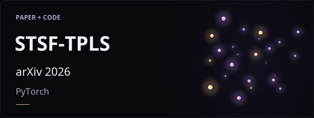
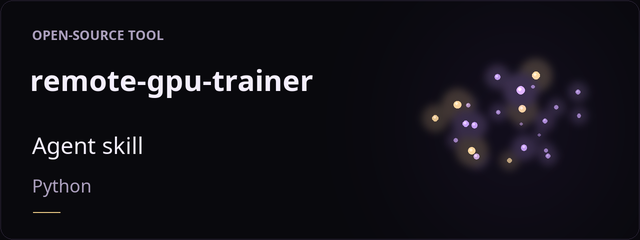
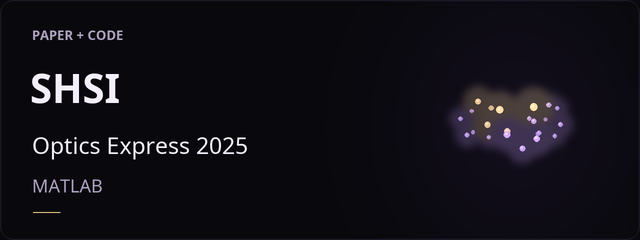
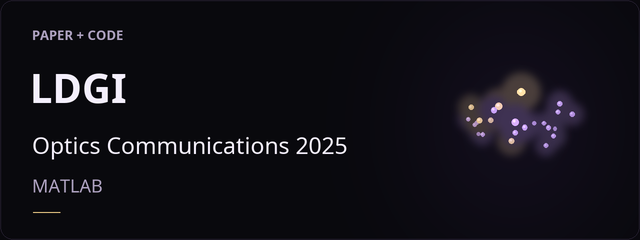
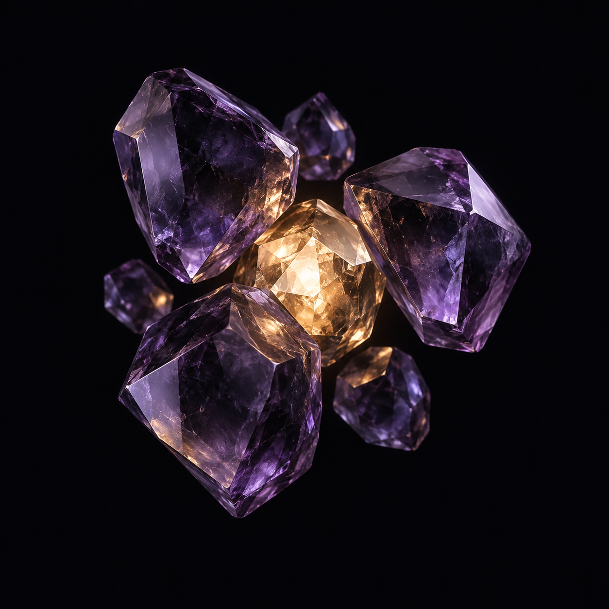

# Profile visuals · still images

[Back to profile](https://github.com/Hanyuyuan6)

  

### Featured work

<table width="100%">
  <tr>
    <td width="50%" align="center"></td>
    <td width="50%" align="center"></td>
  </tr>
  <tr>
    <td width="50%" align="center"></td>
    <td width="50%" align="center"></td>
  </tr>
</table>

### Avatar

  

Visuals are conceptual illustrations.
